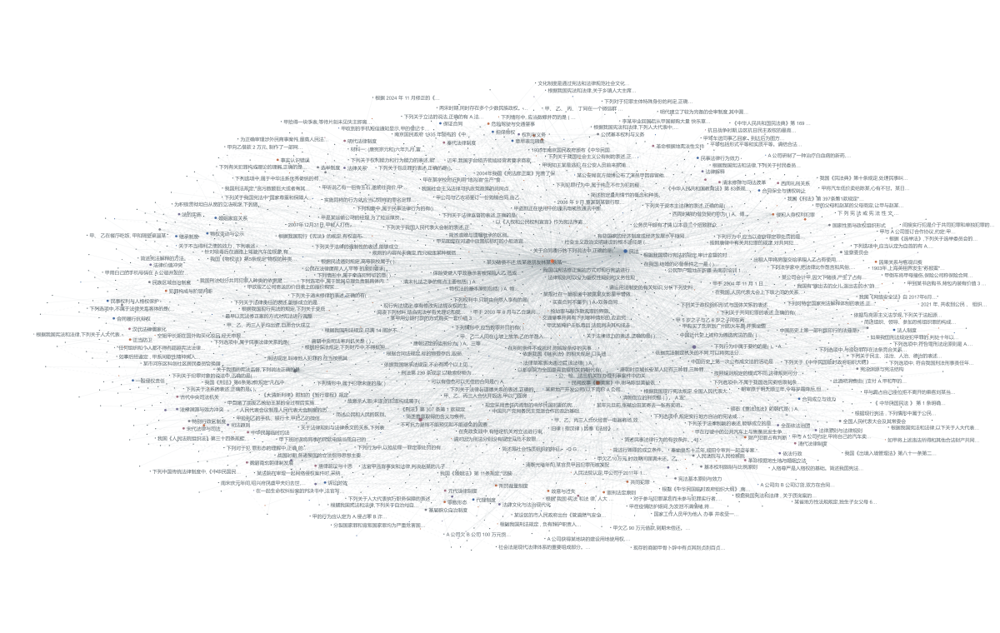
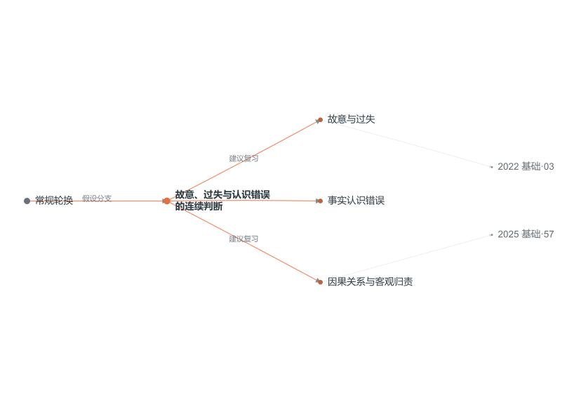
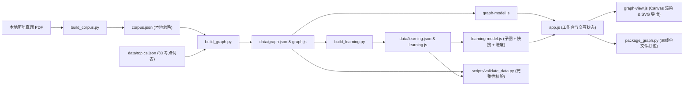

# 法硕关系网 · Law Exam Atlas

[](https://johnson-durui.github.io/law-exam-atlas/)
[](#快速运行与单文件打包)
[](#架构与数据流水线)
[](#三个核心内容入口)

**[打开在线交互版](https://johnson-durui.github.io/law-exam-atlas/)** · **[学习冲刺工作台](https://johnson-durui.github.io/law-exam-atlas/study/)** · **[GitHub 仓库](https://github.com/Johnson-Durui/law-exam-atlas)**

> 项目文档：[产品设计档案](docs/DESIGN.md) · [快速交接指南](docs/HANDOFF.md) · [协作约定](docs/AGENTS.md) · [来源与边界说明](NOTICE.md) · [代码与材料许可](LICENSE)

**法硕关系网（Law Exam Atlas）** 是一个零外部依赖、支持纯本地离线运行的法硕历年真题知识图谱与备考推演工作台。以克制的白底、黑灰文字、深蓝导航与暖橙分支呈现 **1,579 道可追溯真题、80 个核心考点、5 条学科审题路线与 20 个 2027 备考考向假设**。

[](https://johnson-durui.github.io/law-exam-atlas/)

*▲ 真题全网视图：点击上方图片进入在线交互版，可滚轮缩放、筛选年份/科目并追踪每条候选关联的原文依据。*

---

## 三个核心内容入口

| 内容入口 | 核心数据与组织结构 | 适用复习场景 |
| --- | --- | --- |
| **真题全网** | **1,579** 道已提取真题、**80** 个考点、**6,025** 条图谱关系 | 按年份、科目、题型、关键词检索原题，沿“候选考点”与跨科比较边串联历年命题脉络 |
| **知识逻辑** | **5** 科审题路线（刑法 / 民法 / 法理学 / 宪法学 / 法制史），共 **27** 个判断步骤 | 零基础建立“先问什么、再查什么、如何落结论”的分步答题框架，直连具体考点与真题 |
| **2027 考向** | **20** 个备考分支（五科各 4 个），分属常规轮换、补充覆盖、情境迁移 **3** 类情景 | 展开复习假设子图、分步拆解、原创拟题练习、自查要点与近年真题词语线索 |

[](https://johnson-durui.github.io/law-exam-atlas/#forecast-cr-01)

*▲ 2027 考向分支视图：从备考情景展开考向、关联考点与真实历史题线索（支持 `#forecast-cr-01` 等独立深链直接分享）。*

---

## 高效复习工作流：快速直达与本地复盘进度

除了 **全景（沉浸式画布）**、**工作台（目录 + 画布 + 详情三栏）** 与 **题库（列表速览）** 三种展示模式外，内置两项纯本地无服务端辅助工具：

1. **毫秒级全局快速跳转（`/` 或 `Ctrl+K`）**
   - 在页面任意非输入状态下按 `/`（或任意位置按 `Ctrl+K` / `Cmd+K`），即可唤起全局命令搜索面板。
   - 同时检索 **20 个 2027 考向、80 个核心考点、5 条学科审题路线与 1,579 道真题**，支持题号/代码直达（如 `cr04`、`forecast-cr-01`、`q-2025-base-57`）、关键词匹配（如 `善意取得`）及缩写子序列匹配（如 `正防` → `正当防卫`、`表代` → `代理制度`）。
2. **本地重点收藏与复盘进度（`★ 重点收藏` / `✓ 已复盘`）**
   - 在任意 **2027 考向** 或 **考点** 详情页，可一键标记 `★ 重点收藏` 或 `✓ 已复盘`，顶部实时统计 `已复盘 X / 20 考向`。
   - 工作台支持按 `全部状态 / ★ 重点收藏 / ○ 待复盘 / ✓ 已复盘` 过滤考向分支。
   - 数据仅保存在当前浏览器本地（支持无 `localStorage` 严格环境自动内存降级），并在“复习进度”面板中提供 **导出进度 JSON** 与 **导入进度 JSON**，方便跨设备离线迁移备份。

---

## 键盘快捷键一览

| 作用域 | 按键 | 功能说明 |
| --- | --- | --- |
| **全局导航** | `/` 或 `Ctrl+K` (`Cmd+K`) | 打开全局快速跳转面板，直达任意考向、考点、路线或真题 |
| **全局导航** | `Esc` | 关闭当前弹窗、快速预览卡片或全景悬浮侧栏 |
| **快速跳转面板** | `↑` / `↓` · `Enter` | 上下切换候选结果 · 立即跳转到选中节点并展开详情 |
| **图谱画布（聚焦后）** | `←` `↑` `↓` `→` | 平移当前图谱视口 |
| **图谱画布（聚焦后）** | `+` / `-` · `Home` | 围绕画布中心缩放 · 一键重新适配全图视野 |
| **图谱画布（聚焦后）** | `N` / `Shift+N` · `E` | 循环切换下一个 / 上一个节点 · 切换下一条关系边 |

---

## 架构与数据流水线

本项目采用**静态预计算 JSON/JS 双格式数据 + 零构建原生 Canvas/SVG 双渲染引擎**设计，既可直接部署在 GitHub Pages，也可双击 `index.html` 通过 `file://` 协议零服务器打开。



### 目录结构

```text
law-exam-atlas/
├── index.html               # 主应用入口（支持 GitHub Pages 与本地 file:// 直开）
├── style.css                # 响应式三栏工作台、沉浸式全景与弹窗样式
├── graph-model.js           # 基础真题图谱校验、多维筛选与邻接查询模型
├── learning-model.js        # 知识逻辑路线、2027 考向子图、全局快搜与本地进度存储
├── graph-view.js            # 零依赖 HTML5 Canvas 密集图/逻辑图渲染器与矢量 SVG 导出
├── app.js                   # 视图编排、深链路由、快速跳转面板与复习进度管理
├── data/                    # 预构建图谱与学习层数据（JSON + 离线脚本加载用 JS）
├── study/                   # 独立冲刺练习工作台静态子应用
├── assets/                  # README 预览图与关系网视觉示意
├── scripts/validate_data.py # 图谱节点、边引用完整性、统计口径与打包自检脚本
├── build_corpus.py          # 本地原卷 PDF 提取与题号连续性核验（需 pypdf 与本地原卷）
├── build_graph.py           # 题库与考点词表图谱构建器
├── build_learning.py        # 2027 备考假设与五科审题路线生成器
├── package_graph.py         # 资源指纹更新与单文件离线 HTML / ZIP 打包脚本
├── tests/                   # 零依赖 Node.js 单元/渲染/DOM 集成测试与 Python 数据流水线测试
└── docs/                    # 产品设计档案 (DESIGN.md)、交接记录 (HANDOFF.md) 与协作规范
```

---

## 快速运行与单文件打包

### 1. 直接使用（零安装）

- **在线访问**：打开 [https://johnson-durui.github.io/law-exam-atlas/](https://johnson-durui.github.io/law-exam-atlas/)。
- **本地离线运行**：克隆或下载仓库后，直接在现代浏览器中打开 `index.html` 即可完整使用，无需启动任何本地服务器、无需账号或 API 密钥。

### 2. 生成内嵌数据的离线单文件 HTML

```bash
# 生成内嵌全部 CSS/JS/图谱数据的单文件版（全屏版 / 工作台版 / ZIP 离线包）
python package_graph.py --output-dir dist
```

### 3. 工程校验与自动化测试

```bash
# 运行全部 8 套 JavaScript 模型、渲染器、快速跳转与虚拟 DOM 集成测试
node tests/run_all.cjs

# 运行 Python 数据结构完整性、JS 包装一致性与单文件打包冒烟验证
python scripts/validate_data.py --check-package
pytest tests/test_data_pipeline.py
```

---

## 内容边界与材料权利说明

1. **提取范围与核对提示**：2005—2026 年材料覆盖存在客观缺口（2020 两卷、2021 综合课、2024 两卷无可靠完整题面，部分早期试卷亦有缺题）。当前入库 **1,579** 道题中，**1,035** 道为自动提取，**544** 道标为“提取待核对”。自动提取不等同于人工逐字校勘，遇到排版断行或旧法表述请按页码核对原卷。
2. **候选关联与历史语境**：试题与考点的连线由题干及选项关键词自动匹配生成，可能命中干扰项；连线仅供检索定位，**不能作为标准答案或官方考点定论**。历史真题反映当年立法背景，跨科与法制史连线仅用于学习比较，不可直接互相套用规则。
3. **预测假设边界**：2027 考向分支属于结构化复习情景（常规轮换、补充覆盖、情境迁移），**不包含任何命题概率、押题承诺或经验证的命中率**，也不采用“上年考过次年必不考”的排除规则。每个分支所附拟题均为原创练习，独立标注且不计入历年真题数量。
4. **版权与开源范围**：公开仓库仅包含独立编写的前端/脚本代码（见 [LICENSE](LICENSE)）及可追溯题文索引，未附带任何原卷 PDF 或外部教材文件。历年真题材料本身的著作权及相关权利归原权利人所有，详见 [NOTICE.md](NOTICE.md)。
